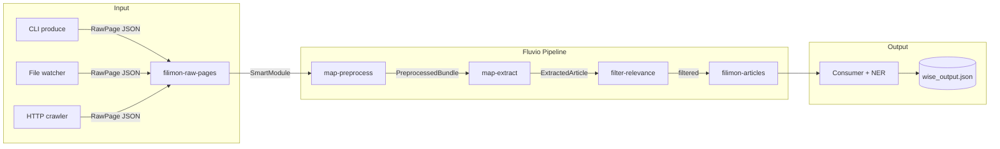

# filimon (`fili`)

A Rust-based semantic news crawler that implements the [WISE framework](https://www.nature.com/articles/s41598-025-25616-x) (Web-Intelligent Semantic Extractor) with real-time streaming via [Fluvio](https://fluvio.io) and zero-shot Named Entity Recognition powered by [GLiNER](https://github.com/fbilhaut/gline-rs).

---

## Overview

filimon is a streaming-first news extraction pipeline:

1. **Fluvio Streaming** — Records flow through topics with SmartModule transformations
2. **WISE Pipeline** — Four-stage semantic extraction implemented as chainable SmartModules
3. **GLiNER NER** — Zero-shot Named Entity Recognition in the main application (ONNX models too large for WASM)



### Pipeline Stages (SmartModules)

| Stage | SmartModule | Input | Output |
|-------|-------------|-------|--------|
| 1 | `map-preprocess` | `RawPage` (url, html) | `PreprocessedBundle` (tokens, frequencies) |
| 2 | `map-extract` | `PreprocessedBundle` | `ExtractedArticle` (title, body, relevance) |
| 3 | `filter-relevance` | `ExtractedArticle` | Pass/reject based on relevance >= 0.05 |
| 4 | Consumer app | `ExtractedArticle` | JSON with optional NER enrichment |

---

## Quick Start

### Prerequisites

- Rust 1.85.0 (required for SmartModule WASM compilation)
- Fluvio CLI 0.18.1+
- Docker (optional, for containerized deployment)

### 1. Install Fluvio

Download binaries directly from GitHub releases:

```bash
# Create directories
mkdir -p ~/.fluvio/bin

# Download Fluvio CLI (choose your architecture)
# For macOS x86_64:
curl -L -o /tmp/fluvio.zip "https://github.com/fluvio-community/fluvio/releases/download/v0.18.1/fluvio-x86_64-apple-darwin.zip"
# For macOS ARM64:
# curl -L -o /tmp/fluvio.zip "https://github.com/fluvio-community/fluvio/releases/download/v0.18.1/fluvio-aarch64-apple-darwin.zip"
# For Linux x86_64:
# curl -L -o /tmp/fluvio.zip "https://github.com/fluvio-community/fluvio/releases/download/v0.18.1/fluvio-x86_64-unknown-linux-musl.zip"

unzip /tmp/fluvio.zip -d ~/.fluvio/bin/
chmod +x ~/.fluvio/bin/fluvio

# Download SMDK (SmartModule Development Kit)
curl -L -o /tmp/smdk.zip "https://github.com/fluvio-community/fluvio/releases/download/v0.18.1/smdk-x86_64-apple-darwin.zip"
unzip /tmp/smdk.zip -d ~/.fluvio/bin/
chmod +x ~/.fluvio/bin/smdk

# Download fluvio-run (for local cluster)
curl -L -o /tmp/fluvio-run.zip "https://github.com/fluvio-community/fluvio/releases/download/v0.18.1/fluvio-run-x86_64-apple-darwin.zip"
unzip /tmp/fluvio-run.zip -d ~/.fluvio/bin/
chmod +x ~/.fluvio/bin/fluvio-run

# Add to PATH
echo 'export PATH="$HOME/.fluvio/bin:$PATH"' >> ~/.zshrc
source ~/.zshrc

# Verify
fluvio version
smdk version
```

### 2. Install Rust 1.85 and WASM targets

```bash
# Install Rust 1.85 (required for SmartModule compilation)
rustup install 1.85.0
rustup target add wasm32-unknown-unknown --toolchain 1.85.0
rustup target add wasm32-wasip1 --toolchain 1.85.0

# Set as default for this project
cd filimon
rustup override set 1.85.0
```

> **Note**: Rust 1.96+ has a known linker issue (`undefined symbol: copy_records`) with fluvio-smartmodule 0.50.1. Use Rust 1.85.0 for SmartModule compilation.

### 3. Start Fluvio Cluster

```bash
# Start local cluster
fluvio cluster start

# Verify
fluvio cluster status
fluvio version
```

### 4. Create Topics

```bash
fluvio topic create filimon-raw-pages
fluvio topic create filimon-articles

# Verify
fluvio topic list
```

### 5. Build and Load SmartModules

```bash
cd filimon

# Build all SmartModules
cd smartmodules/filter-relevance && smdk build && cd ../..
cd smartmodules/map-preprocess && smdk build && cd ../..
cd smartmodules/map-extract && smdk build && cd ../..

# Load to cluster
cd smartmodules/filter-relevance && smdk load && cd ../..
cd smartmodules/map-preprocess && smdk load && cd ../..
cd smartmodules/map-extract && smdk load && cd ../..

# Verify
fluvio smartmodule list
```

Expected output:
```
  SMARTMODULE                     SIZE    
  filimon/map-preprocess@0.1.0    86.4 KB 
  filimon/map-extract@0.1.0       95.3 KB 
  filimon/filter-relevance@0.1.0  72.3 KB 
```

### 6. Test the Pipeline

```bash
# Create transforms file
cat > transforms.yaml << 'EOF'
transforms:
  - uses: filimon/map-preprocess@0.1.0
  - uses: filimon/map-extract@0.1.0
  - uses: filimon/filter-relevance@0.1.0
EOF

# Produce a test record
echo '{"url":"https://example.com/news","html":"<html><head><title>Breaking News</title></head><body><h1>Tech Market Surges</h1><p>The technology market experienced significant growth today as investors rallied around artificial intelligence stocks.</p></body></html>"}' | fluvio produce filimon-raw-pages

# Consume with full pipeline
fluvio consume filimon-raw-pages -B -d --transforms-file transforms.yaml
```

Expected output:
```json
{"url":"https://example.com/news","title":"Tech Market Surges","author":null,"published_date":null,"body_preview":"The technology market experienced significant growth today...","word_count":16,"relevance_score":0.43,"top_keywords":["artificial","intelligence","market","technology"],"named_entities":[],"inferred_category":"Business"}
```

---

## CLI Usage

### Modes

```bash
# Produce raw HTML to the pipeline
fili produce https://techcrunch.com

# Consume processed articles
fili consume --limit 10

# Watch directories and produce HTML files
fili watch /tmp/articles

# Process local files
fili file ./samples/article.html
```

### CLI Options

```
Commands:
  produce   Crawl URL and produce to Fluvio
  consume   Consume processed articles from Fluvio
  watch     Watch directories for HTML files
  file      Process local HTML files

Options:
  --tokenizer <PATH>   GLiNER tokenizer.json [env: TOKENIZER_PATH]
  --model <PATH>       GLiNER model.onnx [env: MODEL_PATH]
  --output <PATH>      JSON output file [env: OUTPUT_PATH]
  --threshold <FLOAT>  Minimum relevance score [default: 0.05]
```

---

## SmartModules

### map-preprocess

Converts raw HTML into tokenized content:
- Extracts visible text (strips scripts, styles, tags)
- Tokenizes and lemmatizes
- Computes term frequencies
- Filters stop words

**Input**: `RawPage { url, html }`  
**Output**: `PreprocessedBundle { raw_page, tokens }`

### map-extract

Extracts structured article data:
- Title (og:title, h1, title tag)
- Author (meta author, article:author)
- Published date (article:published_time, time[datetime])
- Body preview (first 500 chars)
- Relevance score (TF-IDF based on news topic terms)
- Top keywords
- Inferred category (Politics, Business, Health & Science, etc.)

**Input**: `PreprocessedBundle`  
**Output**: `ExtractedArticle`

### filter-relevance

Filters articles by relevance score:
- Threshold: 0.05 (configurable via constant)
- Rejects empty/low-quality pages

**Input**: `ExtractedArticle`  
**Output**: `ExtractedArticle` (pass) or filtered out

---

## GLiNER NER Setup

Named Entity Recognition runs in the main application (not in SmartModules) due to ONNX model size constraints.

### Download Model

```bash
# Using Docker helper
docker compose --profile setup up model-downloader

# Or manually
pip install huggingface_hub
python - <<'EOF'
from huggingface_hub import snapshot_download
snapshot_download(
    repo_id="urchade/gliner_small-v2.1",
    local_dir="models/gliner_small-v2.1",
    ignore_patterns=["*.pt", "*.bin", "flax_model*", "tf_model*"],
)
EOF
```

### Model Directory Structure

```
models/
└── gliner_small-v2.1/
    ├── tokenizer.json
    └── onnx/
        └── model.onnx
```

### Environment Variables

| Variable | Description | Default |
|----------|-------------|---------|
| `TOKENIZER_PATH` | GLiNER tokenizer.json | `models/gliner_small-v2.1/tokenizer.json` |
| `MODEL_PATH` | GLiNER model.onnx | `models/gliner_small-v2.1/onnx/model.onnx` |
| `OUTPUT_PATH` | JSON results file | `wise_output.json` |

> filimon runs without a model — NER fields will be empty. All other pipeline stages function normally.

---

## Docker

### Start Fluvio with Docker Compose

The docker-compose.yml includes separate SC (Streaming Controller) and SPU (Streaming Processing Unit) services:

```bash
# Start Fluvio cluster
docker compose up -d fluvio-sc fluvio-spu

# Check logs
docker logs fluvio-sc
docker logs fluvio-spu
```

### Run filimon container

```bash
# Build
docker compose build filimon

# Produce
docker compose run --rm filimon produce https://techcrunch.com

# Consume
docker compose run --rm filimon consume --limit 10
```

### Full docker-compose.yml

See the `docker-compose.yml` file for:
- `fluvio-sc` — Streaming Controller
- `fluvio-spu` — Streaming Processing Unit
- `filimon` — Main crawler service
- `filimon-stream-processor` — Continuous stream processor (optional)
- `model-downloader` — GLiNER model downloader

---

## Project Structure

```
filimon/
├── src/
│   ├── main.rs          # CLI, Fluvio producer/consumer
│   ├── check.rs         # Directory validation
│   ├── models.rs        # Shared data structs (RawPage, ExtractedArticle, etc.)
│   ├── streaming.rs     # Fluvio client wrapper, typed producer/consumer
│   ├── scorer.rs        # GLiNER NER engine
│   └── output.rs        # JSON serialization, console output
├── smartmodules/
│   ├── filter-relevance/
│   │   ├── Cargo.toml
│   │   ├── SmartModule.toml
│   │   └── src/lib.rs
│   ├── map-preprocess/
│   │   ├── Cargo.toml
│   │   ├── SmartModule.toml
│   │   └── src/lib.rs
│   └── map-extract/
│       ├── Cargo.toml
│       ├── SmartModule.toml
│       └── src/lib.rs
├── Cargo.toml           # Workspace config
├── docker-compose.yml
├── transforms.yaml      # SmartModule chain config
└── README.md
```

---

## Dependencies

| Crate | Purpose |
|-------|---------|
| `fluvio` | Streaming platform client |
| `fluvio-smartmodule` | SmartModule WASM framework |
| `clap` | CLI argument parsing |
| `watchexec` | Filesystem event watching |
| `tokio` | Async runtime |
| `reqwest` | HTTP client |
| `scraper` | HTML parsing |
| `gline-rs` | GLiNER NER inference |
| `serde` / `serde_json` | JSON serialization |
| `miette` | Error reporting |
| `tracing` | Logging |

---

## Troubleshooting

### SmartModule build fails with "undefined symbol: copy_records"

Use Rust 1.85.0:
```bash
rustup install 1.85.0
rustup override set 1.85.0
```

### Fluvio cluster won't start

Check if ports are in use:
```bash
lsof -i :9003
lsof -i :9010
```

Kill existing processes or change ports.

### SmartModule load fails

Ensure SmartModule.toml has required fields:
```toml
[package]
name = "my-smartmodule"
group = "filimon"
version = "0.1.0"
apiVersion = "0.1.0"
description = "..."
license = "Apache-2.0"
visibility = "private"

[[params]]
name = "unused"
description = "No parameters required"
```

### Docker Fluvio SPU registration fails

The SPU needs to register with the SC. Ensure:
1. SC is healthy before starting SPU
2. Network connectivity between containers
3. Correct `--sc-addr` flag

For local development, prefer native `fluvio cluster start` over Docker.

---

## License

MIT
