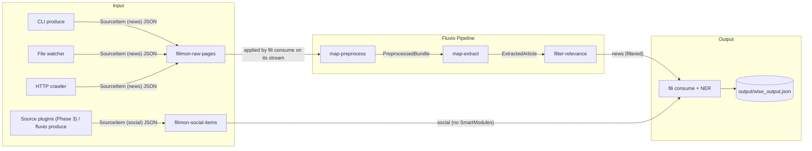

# filimon (`fili`)

A Rust-based semantic news crawler that implements the [WISE framework](https://www.nature.com/articles/s41598-025-25616-x) (Web-Intelligent Semantic Extractor) with real-time streaming via [Fluvio](https://fluvio.io) and zero-shot Named Entity Recognition powered by [GLiNER](https://github.com/fbilhaut/gline-rs).

---

## Overview

filimon is a streaming-first news extraction pipeline:

1. **Fluvio Streaming** — Every item enters as a `SourceItem` JSON record. News pages go to `filimon-raw-pages`; social posts go to `filimon-social-items`
2. **WISE Pipeline** — Four-stage semantic extraction implemented as chainable SmartModules, applied to the news stream only
3. **GLiNER NER** — Zero-shot Named Entity Recognition in the main application (ONNX models too large for WASM)



`fili consume` opens one stream on `filimon-raw-pages` with the three SmartModules attached and one plain stream on `filimon-social-items`, merges them, and writes every record into one JSON array.

### Pipeline Stages (SmartModules)

| Stage | SmartModule | Input | Output |
|-------|-------------|-------|--------|
| 1 | `map-preprocess` | `SourceItem` (news), read as `RawPage` (url, html) | `PreprocessedBundle` (tokens, frequencies) |
| 2 | `map-extract` | `PreprocessedBundle` | `ExtractedArticle` (title, body, relevance) |
| 3 | `filter-relevance` | `ExtractedArticle` | Pass/reject based on relevance >= 0.05 |
| 4 | `fili consume` | `ExtractedArticle` (news) and `SourceItem` (social) | One JSON array of output records, with optional NER enrichment |

---

## Quick Start

### Prerequisites

- Rust 1.96.0 for the `fili` binary and the plugin host (pinned by the root `rust-toolchain.toml`, installed automatically by rustup)
- Rust 1.85.0 for the SmartModules (pinned by each `smartmodules/*/rust-toolchain.toml`)
- Fluvio CLI 0.18.1+
- Docker (optional, for containerized deployment)

### 1. Install Fluvio

Download binaries directly from GitHub releases:

```bash
# Create directories
mkdir -p ~/.fluvio/bin

# Download Fluvio CLI (choose your architecture)
# For macOS x86_64:
curl -L -o /tmp/fluvio.zip "https://github.com/fluvio-community/fluvio/releases/download/v0.18.1/fluvio-x86_64-apple-darwin.zip"
# For macOS ARM64:
# curl -L -o /tmp/fluvio.zip "https://github.com/fluvio-community/fluvio/releases/download/v0.18.1/fluvio-aarch64-apple-darwin.zip"
# For Linux x86_64:
# curl -L -o /tmp/fluvio.zip "https://github.com/fluvio-community/fluvio/releases/download/v0.18.1/fluvio-x86_64-unknown-linux-musl.zip"

unzip /tmp/fluvio.zip -d ~/.fluvio/bin/
chmod +x ~/.fluvio/bin/fluvio

# Download SMDK (SmartModule Development Kit)
curl -L -o /tmp/smdk.zip "https://github.com/fluvio-community/fluvio/releases/download/v0.18.1/smdk-x86_64-apple-darwin.zip"
unzip /tmp/smdk.zip -d ~/.fluvio/bin/
chmod +x ~/.fluvio/bin/smdk

# Download fluvio-run (for local cluster)
curl -L -o /tmp/fluvio-run.zip "https://github.com/fluvio-community/fluvio/releases/download/v0.18.1/fluvio-run-x86_64-apple-darwin.zip"
unzip /tmp/fluvio-run.zip -d ~/.fluvio/bin/
chmod +x ~/.fluvio/bin/fluvio-run

# Add to PATH
echo 'export PATH="$HOME/.fluvio/bin:$PATH"' >> ~/.zshrc
source ~/.zshrc

# Verify
fluvio version
smdk version
```

### 2. Install Rust toolchains and WASM targets

```bash
# Rust 1.85.0 builds the SmartModules
rustup install 1.85.0
rustup target add wasm32-unknown-unknown --toolchain 1.85.0
rustup target add wasm32-wasip1 --toolchain 1.85.0

# Rust 1.96.0 builds the fili binary and the plugin host
rustup install 1.96.0
```

No repository-wide `rustup override` is needed. The root `rust-toolchain.toml` selects 1.96.0, and each `smartmodules/*/rust-toolchain.toml` selects 1.85.0 for that directory.

> **Note**: Rust 1.96+ cannot link SmartModules: the build fails with `undefined symbol: copy_records` with fluvio-smartmodule 0.50.1. Build SmartModules from inside their own directory with `smdk build` so the nested 1.85.0 pin applies.

### 3. Start Fluvio Cluster

```bash
# Start local cluster
fluvio cluster start

# Verify
fluvio cluster status
fluvio version
```

### 4. Create Topics

```bash
fluvio topic create filimon-raw-pages
fluvio topic create filimon-social-items

# Verify
fluvio topic list
```

`fili produce`, `fili file` and `fili watch` create `filimon-raw-pages` automatically if it is missing. `fili` never creates `filimon-social-items`; create it by hand. Before it opens any stream, `fili consume` checks that every topic and SmartModule it needs exists, and stops with an error that names each missing one, for example:

```
Topic `filimon-social-items` not found. Create it with: fluvio topic create filimon-social-items
```

### 5. Build and Load SmartModules

```bash
cd filimon

# Build all SmartModules
cd smartmodules/filter-relevance && smdk build && cd ../..
cd smartmodules/map-preprocess && smdk build && cd ../..
cd smartmodules/map-extract && smdk build && cd ../..

# Load to cluster
cd smartmodules/filter-relevance && smdk load && cd ../..
cd smartmodules/map-preprocess && smdk load && cd ../..
cd smartmodules/map-extract && smdk load && cd ../..

# Verify
fluvio smartmodule list
```

Expected output:
```
  SMARTMODULE                     SIZE    
  filimon/map-preprocess@0.1.0    86.4 KB 
  filimon/map-extract@0.1.0       95.3 KB 
  filimon/filter-relevance@0.1.0  72.3 KB 
```

### 6. Test the Pipeline

```bash
# Create transforms file
cat > transforms.yaml << 'EOF'
transforms:
  - uses: filimon/map-preprocess@0.1.0
  - uses: filimon/map-extract@0.1.0
  - uses: filimon/filter-relevance@0.1.0
EOF

# Produce a news SourceItem (the chain reads only its url and html)
echo '{"source_type":"news","platform":"example.com","id":"https://example.com/news","url":"https://example.com/news","title":null,"text":"","html":"<html><head><title>Breaking News</title></head><body><h1>Tech Market Surges</h1><p>The technology market experienced significant growth today as investors rallied around artificial intelligence stocks.</p></body></html>"}' | fluvio produce filimon-raw-pages

# Check the SmartModule chain by hand
fluvio consume filimon-raw-pages -B -d --transforms-file transforms.yaml
```

Expected output:
```json
{"url":"https://example.com/news","title":"Tech Market Surges","author":null,"published_date":null,"body_preview":"The technology market experienced significant growth today as investors rallied around artificial intelligence stocks.","word_count":17,"relevance_score":0.4477471976888375,"top_keywords":["market","around","artificial","break","experienc","growth","intelligence","investor","news","ralli","significant","stock"],"named_entities":[],"inferred_category":"Business"}
```

Then send a social `SourceItem` and read both kinds with `fili`:

```bash
# Produce a social SourceItem (no SmartModules touch this topic)
echo '{"source_type":"social","platform":"reddit","id":"t3_fili02","url":"https://www.reddit.com/r/rust/comments/fili02","title":null,"text":"lol cat","author":"u1","published":"2024-10-27T03:33:20.123Z","raw":{"score":3}}' | fluvio produce filimon-social-items

# Read news (through the chain) and social items into output/wise_output.json
fili consume --from-beginning --limit 10
```

The social record `t3_fili02` appears in the output even though its text, `lol cat`, would be dropped by `filter-relevance` if it were sent as news: social items never pass through the SmartModule chain. `--limit` counts news and social records together, so raise it if the topics already hold many records.

---

## CLI Usage

### Modes

```bash
# Crawl pages and produce them as news SourceItems
fili produce https://techcrunch.com

# Read news and social items into output/wise_output.json
fili consume --limit 10

# Watch directories and produce HTML files
fili --ls /tmp/articles watch

# Process local files
fili file ./samples/article.html

# Inspect, validate and try the registered source plugins (see plugins/README.md)
fili plugins list
fili plugins check stub
fili plugins run-once stub

# Poll every enabled source plugin and produce its items to Fluvio until Ctrl+C
fili run
```

### Crawling through a fetcher component

`fili produce` uses its built-in HTTP client by default. To fetch its pages
through a fetcher component instead, add a `[crawler]` table to the registry
file (`--registry`, `FILI_REGISTRY`, default `filimon.toml`). It names a fetcher
defined under `[fetchers]` in the same file:

```toml
[fetchers.http]
component = "plugins/http-fetcher/target/wasm32-unknown-unknown/release/http_fetcher.wasm"

[crawler]
fetcher = "http"
timeout_secs = 15              # optional, default 15
allowlist = ["www.example.com"] # optional, extra hosts besides the seed urls' hosts
```

`fili produce` says which client it uses, one line before the crawl starts:

- no registry file: `[Crawl] No plugin registry at <path>; using the built-in HTTP client`
- a registry without a `[crawler]` table: `[Crawl] <path> has no [crawler] table; using the built-in HTTP client`
- a `[crawler]` table: ``[Crawl] fetching through the fetcher `<name>`, timeout <n> s, hosts: <hosts>``

A `[crawler]` table that cannot be used (an undefined or disabled fetcher, a
component that does not load) is an error, and nothing is crawled.

The hosts the crawler may reach are the hosts of the seed urls plus
`allowlist`, matched by exact host name. A link that redirects to any other host
is denied by name, and that page is skipped. Articles still reach the consumer
through the same topic and SmartModule chain. The fetcher path validates
certificates; the built-in client keeps its existing behaviour, which does not.
See [`plugins/README.md`](plugins/README.md#fetcher-layer) for the full rules.

### `fili consume`

`fili consume` reads news from `filimon-raw-pages` through the three SmartModules and social items from `filimon-social-items` with no SmartModules, and merges both into one output.

| Flag | Meaning |
|------|---------|
| `--limit <N>` | Stop after N records, counting news and social together. `0` (the default) streams without end and prints records instead of writing a file |
| `--from-beginning` | Start at the first record of each topic |
| `--source <SOURCE>` | `both` (default), `news` or `social`. Only the selected topics and SmartModules are opened and checked |
| `--output <PATH>` | JSON output file in `--limit` mode [default: `output/wise_output.json`] |
| `--enrich-ner` | Run GLiNER NER on news and social records, in `--limit` mode only |

In `--limit` mode the output file is one JSON array. Every record has the same fields; `article` is set for news and `null` for social:

```json
[
  {"source_type":"news","platform":"local","id":"file://examples/fixtures/news-article.html","url":"file://examples/fixtures/news-article.html","title":"Parliament passes national climate policy bill","text":"Parliament passes national climate policy bill The government won a decisive vote in parliament today...","author":"Jane Reporter","published":"2024-05-01T09:00:00Z","raw":null,"entities":[],"article":{"relevance_score":0.48933290145634056,"top_keywords":["bill","climate","policy","national","parliament","economy","energy","government","next","passe","research","said"],"inferred_category":"Politics","word_count":70,"published_raw":"2024-05-01T10:00:00+01:00"}},
  {"source_type":"social","platform":"reddit","id":"t3_fili02","url":"https://www.reddit.com/r/rust/comments/fili02","title":null,"text":"lol cat","author":"u1","published":"2024-10-27T03:33:20.123Z","raw":{"score":3},"entities":[],"article":null}
]
```

`published` is an RFC 3339 UTC timestamp or `null`; for news, the date string exactly as the page gave it is kept in `article.published_raw`. `entities` stays empty unless `--enrich-ner` is set and a model is available. Page HTML is never written to the output.

### CLI Options

```
Commands:
  produce  Produce crawled pages to Fluvio for pipeline processing
  consume  Consume news (through the news chain modules) and social items from Fluvio into one JSON output, with optional NER enrichment
  watch    Watch directories and produce HTML files to Fluvio
  file     Produce local HTML files to Fluvio
  plugins  Inspect, validate and try registered plugins (list, check, run-once)
  run      Poll every enabled source plugin on its interval and produce items to Fluvio until stopped

Options:
  --tokenizer <TOKENIZER>  Path to GLiNER tokenizer.json (for NER on consume) [env: TOKENIZER_PATH]
  --model <MODEL>          Path to GLiNER onnx/model.onnx (for NER on consume) [env: MODEL_PATH]
  --registry <REGISTRY>    Path to the plugin registry (filimon.toml) [env: FILI_REGISTRY]
  --state-dir <STATE_DIR>  Directory for per-plugin cursor files [env: FILI_STATE_DIR] [default: .fili-state/ next to the registry]
  --threshold <THRESHOLD>  Relevance threshold for filtering [0.0 - 1.0] [default: 0.05]
  --config <CONFIG>        Path to JSON config file for watch mode [default: config.json]
  --ls <LS>                Comma-separated directories to watch (override config files)
```

---

## SmartModules

### map-preprocess

Converts raw HTML into tokenized content:
- Extracts visible text (strips scripts, styles, tags)
- Tokenizes and lemmatizes
- Computes term frequencies
- Filters stop words

**Input**: `RawPage { url, html }`  
**Output**: `PreprocessedBundle { raw_page, tokens }`

### map-extract

Extracts structured article data:
- Title (og:title, h1, title tag)
- Author (meta author, article:author)
- Published date (article:published_time, time[datetime])
- Body preview (first 500 chars)
- Relevance score (TF-IDF based on news topic terms)
- Top keywords
- Inferred category (Politics, Business, Health & Science, etc.)

**Input**: `PreprocessedBundle`  
**Output**: `ExtractedArticle`

### filter-relevance

Filters articles by relevance score:
- Threshold: 0.05 (configurable via constant)
- Rejects empty/low-quality pages

**Input**: `ExtractedArticle`  
**Output**: `ExtractedArticle` (pass) or filtered out

---

## GLiNER NER Setup

Named Entity Recognition runs in the main application (not in SmartModules) due to ONNX model size constraints.

### Download Model

```bash
# Using Docker helper
docker compose --profile setup up model-downloader

# Or manually
pip install huggingface_hub
python - <<'EOF'
from huggingface_hub import snapshot_download
snapshot_download(
    repo_id="urchade/gliner_small-v2.1",
    local_dir="models/gliner_small-v2.1",
    ignore_patterns=["*.pt", "*.bin", "flax_model*", "tf_model*"],
)
EOF
```

### Model Directory Structure

```
models/
└── gliner_small-v2.1/
    ├── tokenizer.json
    └── onnx/
        └── model.onnx
```

### Environment Variables

| Variable | Description | Default |
|----------|-------------|---------|
| `TOKENIZER_PATH` | GLiNER tokenizer.json | `models/gliner_small-v2.1/tokenizer.json` |
| `MODEL_PATH` | GLiNER model.onnx | `models/gliner_small-v2.1/onnx/model.onnx` |

The JSON output file is set with `fili consume --output <PATH>` (default `output/wise_output.json`).

> filimon runs without a model — `entities` will be empty. All other pipeline stages function normally.

---

## Docker

### Start Fluvio with Docker Compose

The docker-compose.yml includes separate SC (Streaming Controller) and SPU (Streaming Processing Unit) services:

```bash
# Start Fluvio cluster
docker compose up -d fluvio-sc fluvio-spu

# Check logs
docker logs fluvio-sc
docker logs fluvio-spu
```

### Run filimon container

```bash
# Build
docker compose build filimon

# Produce
docker compose run --rm filimon produce https://techcrunch.com

# Consume
docker compose run --rm filimon consume --limit 10
```

### Full docker-compose.yml

See the `docker-compose.yml` file for:
- `fluvio-sc` — Streaming Controller
- `fluvio-spu` — Streaming Processing Unit
- `filimon` — Main crawler service
- `filimon-stream-processor` — Continuous stream processor (optional)
- `model-downloader` — GLiNER model downloader

---

## Project Structure

```
filimon/
├── src/
│   ├── main.rs          # CLI, Fluvio producer/consumer
│   ├── check.rs         # Directory validation
│   ├── models.rs        # Shared data structs (SourceItem, ExtractedArticle, OutputRecord, etc.)
│   ├── streaming.rs     # Fluvio client wrapper, topic names, news SmartModule chain, preflight
│   ├── commands/
│   │   ├── consume.rs   # fili consume: merges news (chain) and social streams, NER, JSON output
│   │   ├── plugins.rs   # fili plugins list | check | run-once
│   │   └── run.rs       # fili run: polls every enabled source plugin into Fluvio until stopped
│   ├── plugins/         # plugin registry, config, secrets and the wasm component host
│   ├── scorer.rs        # GLiNER NER engine
│   └── output.rs        # JSON serialization, console output
├── smartmodules/
│   ├── filter-relevance/
│   │   ├── Cargo.toml
│   │   ├── SmartModule.toml
│   │   └── src/lib.rs
│   ├── map-preprocess/
│   │   ├── Cargo.toml
│   │   ├── SmartModule.toml
│   │   └── src/lib.rs
│   └── map-extract/
│       ├── Cargo.toml
│       ├── SmartModule.toml
│       └── src/lib.rs
├── Cargo.toml           # Workspace config
├── docker-compose.yml
├── transforms.yaml      # SmartModule chain config
└── README.md
```

---

## Dependencies

| Crate | Purpose |
|-------|---------|
| `fluvio` | Streaming platform client |
| `fluvio-smartmodule` | SmartModule WASM framework |
| `clap` | CLI argument parsing |
| `watchexec` | Filesystem event watching |
| `tokio` | Async runtime |
| `reqwest` | HTTP client |
| `scraper` | HTML parsing |
| `gline-rs` | GLiNER NER inference |
| `serde` / `serde_json` | JSON serialization |
| `miette` | Error reporting |
| `tracing` | Logging |

---

## Troubleshooting

### SmartModule build fails with "undefined symbol: copy_records"

Build the SmartModule from inside its own directory, so its nested `rust-toolchain.toml` (Rust 1.85.0) applies:
```bash
rustup install 1.85.0
cd smartmodules/filter-relevance
smdk build
```

Do not run `rustup override set` in the repository root. A root override would also pin the `fili` host crate below the Rust version the wasmtime dependency requires.

### Fluvio cluster won't start

Check if ports are in use:
```bash
lsof -i :9003
lsof -i :9010
```

Kill existing processes or change ports.

### SmartModule load fails

Ensure SmartModule.toml has required fields:
```toml
[package]
name = "my-smartmodule"
group = "filimon"
version = "0.1.0"
apiVersion = "0.1.0"
description = "..."
license = "Apache-2.0"
visibility = "private"

[[params]]
name = "unused"
description = "No parameters required"
```

### Docker Fluvio SPU registration fails

The SPU needs to register with the SC. Ensure:
1. SC is healthy before starting SPU
2. Network connectivity between containers
3. Correct `--sc-addr` flag

For local development, prefer native `fluvio cluster start` over Docker.

---

## License

MIT
